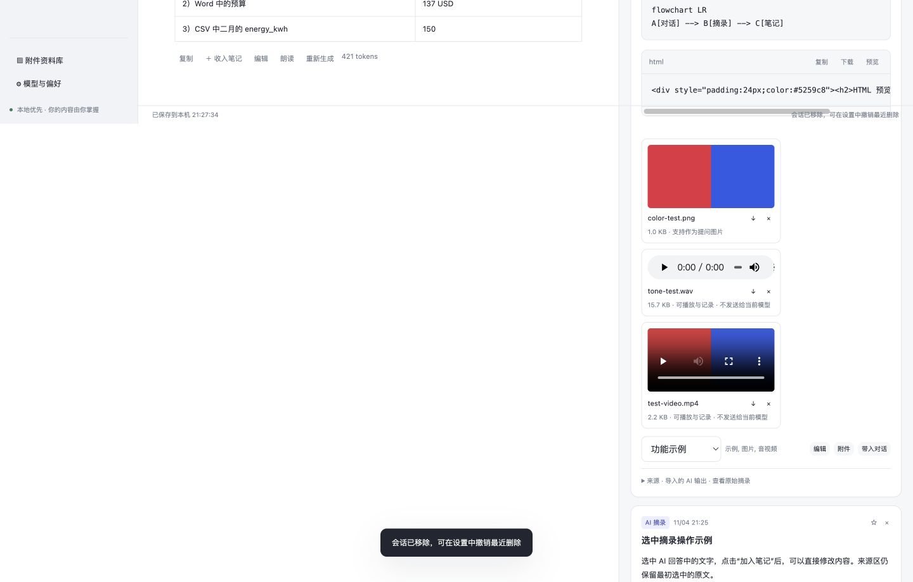
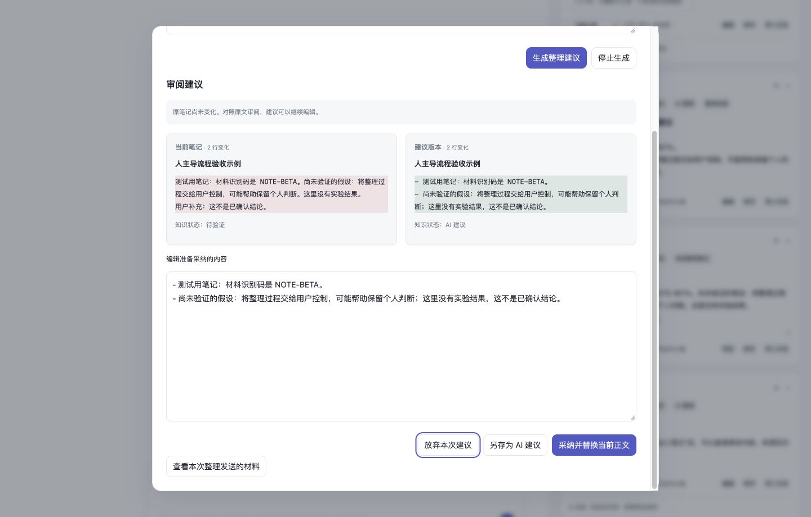

# Picked：把 AI 对话变成自己的知识

**聊天、摘录、编辑、审阅，在同一个工作台完成。**

Picked 是一个面向个人的 AI 聊天与笔记工作台。左侧与模型讨论，右侧整理自己的笔记：选中一段有启发的回答，点击「加入笔记」，就能继续改写、补充理解、保留来源。笔记还能作为下一轮对话的材料，让讨论和积累接着往下走。

它从一个简单的需求出发：**我想自己决定留下什么，并且随时看得到、改得了，而不是每次都让 AI “帮我记下来”。**

[快速开始](#快速开始) · [核心功能](#核心功能) · [使用场景](#使用场景) · [产品出发点](#产品出发点) · [技术文档](docs/ARCHITECTURE.md)



*功能演示数据。聊天和笔记在桌面端并排显示；手机端可切换查看。*

## 概览

Picked 把一次 AI 协作中的几个关键动作连起来：

- **边聊边记**：选中片段直接加入笔记，也能收下整条回答及其附件；在旁边编辑，无需来回复制。
- **保留丰富内容**：阅读 Markdown、表格、代码、公式和流程图，保存图片、音频、视频及文件，导出可离线阅读的笔记。
- **自己选择上下文**：决定这次发送哪些历史、附件和参考笔记，发送前查看实际请求，回答后回看当次材料。
- **让 AI 帮忙整理**：先看修改对照，再编辑、另存或采纳建议；整理草稿与笔记正文分开保存。
- **持续完善知识**：用标签、收藏和知识状态整理内容，保留原始摘录与版本，将已有笔记带回新一轮讨论。

模型负责生成和辅助整理；**哪些内容进入自己的知识库，由你决定。**

## 快速开始

需要 Python 3.9+，无需安装前端依赖。

```bash
git clone https://github.com/wjulien888-tech/picked.git
cd picked
python3 serve.py --open
```

浏览器打开 [http://127.0.0.1:8765/](http://127.0.0.1:8765/)。macOS 也可以双击 `启动Picked.command`。

1. 打开「模型与偏好」，填写 API 地址、模型名称和自己的 API Key，点击「应用配置」。
2. 开始提问，或上传图片、PDF、Word 等材料后提问。
3. 选中回答中想保留的文字，点击「加入笔记」；也可用整条回答下的「收入笔记」。
4. 在笔记本里编辑内容、补充理解，或发起 AI 整理并审阅修改。

提供 DeepSeek、千问和自定义 Chat Completions 兼容接口配置入口。浏览器直接连接模型服务，接口需允许跨域请求；图片等能力取决于所选模型。DeepSeek 的流式对话、图片问答和文档文本问答已做真实 API 检查，其他服务尚未逐一验收。

[托管演示](https://picked-notebook-julia.w-julien888.chatgpt.site/)目前为私有访问，需要账号权限。本地运行不依赖托管演示。

## 核心功能

### 对话与笔记并排：看到价值，直接留下

不必打断讨论，请 AI 代为保存，也不必把整段聊天搬进另一个文档。

- 选中部分回答直接摘录，或保存整条回答与附件。
- 编辑笔记标题和正文，写下自己的解释、疑问和下一步。
- 保留原始摘录和来源，回看结论从哪里来。
- 用多个笔记本、标签、收藏、搜索和筛选管理积累。
- 将笔记作为后续对话的参考材料，继续追问和修订。

### 多模态内容记录：文字之外，也能放进笔记本

讨论一张图、阅读一份报告，或保存一段模型输出，都可以留在同一份资料里。

| 内容 | 当前可以做什么 |
| --- | --- |
| 图片 | 上传、预览、保存到笔记；视觉模型可基于图片回答 |
| PDF、Word、文本、CSV | 本地提取文字用于问答，并保存原文件 |
| 音频、视频 | 保存、播放、下载和收入笔记；播放依赖浏览器格式支持 |
| Markdown、表格与代码 | 排版阅读、复制；代码可下载 |
| LaTeX、Mermaid | 展示公式和流程图 |
| HTML、SVG | 在隔离的预览中查看 |

支持导入已有 AI 输出。音视频目前用于记录与播放，尚未接入模型音视频理解；扫描 PDF 尚不支持自动 OCR。

### 本次材料：让每一轮回答有明确的输入范围

长对话里，并非所有旧内容都适合继续发送。Picked 让你在发送前调整材料，而不只是不断追加消息。

- 选择或排除历史消息、附件和参考笔记。
- 预览将发给模型的请求，下载不含鉴权 Key 的请求 JSON。
- 在回答的「使用的材料」中查看当时的文本快照和附件引用。

例如：讨论另一种方案时，可以排除已经放弃的假设，只带入当前问题和选定笔记。后续修改笔记，也不会改变那一轮已经保存的材料快照。

### AI 整理与修改对照：先审阅，再采纳

Picked 可以请模型整理一条笔记。生成结果先成为独立草稿，用户能看到正文如何变化，再决定如何处理。



- 对照当前正文和建议，直接编辑建议内容。
- 放弃草稿、另存为 AI 建议，或采纳并替换正文。
- 原笔记在生成后发生变化时，阻止旧草稿直接覆盖新正文。
- 采纳后保留版本记录，内容进入「待验证」，由用户继续判断。

### 知识状态与版本：记得下来，也能接着完善

一段回答可以先留下疑问，再逐步形成自己的理解。笔记支持五种由用户设置的状态：

| 状态 | 用途 |
| --- | --- |
| 待整理 | 先收集，稍后处理 |
| AI 建议 | 保留模型提出的内容 |
| 待验证 | 标记还需要核对的判断 |
| 我的理解 | 写下自己的解释与归纳 |
| 已确认 | 标记自己已经核对的内容 |

编辑、调整状态、采纳建议和恢复旧版都会留下版本记录。恢复会产生新版本，方便继续修改和回看演变。

### 本地保存与导出：积累可以带走

- 对话、笔记和上传原文件保存在当前浏览器。
- 完整 JSON 备份包含原文件，可合并导入已有工作区。
- 导出 Markdown，或包含本地图片、音频、视频的离线 HTML。
- 支持多会话搜索、重新生成、停止回答，以及编辑提问后建立对话分支。

## 使用场景

| 场景 | 在 Picked 中的工作方式 | 可以留下什么 |
| --- | --- | --- |
| 学习一个概念 | 追问例子 → 摘录解释 → 改写成自己的话 → 标记待核问题 | 有来源、能继续修订的学习笔记 |
| 阅读报告或研究材料 | 上传文档与图表 → 围绕材料提问 → 保存结论及附件 | 原材料与个人解读放在一起的阅读记录 |
| 推敲产品方案 | 分别讨论不同思路 → 选择本轮上下文 → 整理并审阅修改 | 保留取舍过程和版本的方案笔记 |
| 积累写作与创作素材 | 导入已有输出 → 挑选文字与媒体 → 分类、编辑和导出 | 可继续加工、可离线阅读的素材本 |

## 产品出发点

AI 可以很快生成一份完整的回答，但从“看过回答”到“形成自己的知识”，还需要用户亲自选择、解释、核对和修改。

Picked 希望把这段过程变成可直接操作的界面：**输入什么材料、留下哪句话、怎样重写、何时确认，都有清楚的入口和记录。** 聊天是探索过程，笔记是用户持续维护的成果，AI 可以参与两者。

这也是我们所说的 **human-led harness（以人为主导的模型工作环境）**：围绕模型组织上下文、来源、草稿审阅与版本，让用户能理解和干预协作过程。当前已实现这部分工作流，尚未提供自主工具调用或多步骤任务执行器。

我们希望它帮助用户把讨论转化为可复用的个人积累。是否能进一步改善理解和长期学习效果，仍需要实际使用研究来验证。更多背景见[产品出发点与设计原则](docs/PRODUCT.md)。

## 数据与 API Key

- **本地存储**：工作区和原文件使用 IndexedDB。浏览器、域名和端口之间不自动同步；清除网站数据会删除本地资料，请定期导出完整备份。
- **模型请求**：发送时，选定材料会交给你配置的模型服务，使用相应 API Key 鉴权。
- **记住 Key**：默认仅在页面内存中使用；勾选「在此设备记住 API Key」并应用后，单独存入当前网址的 localStorage，可随时清除。此存储未经加密。
- **备份范围**：应用管理的 Key 不进入工作区、材料记录或导出备份。远程媒体链接不等于原文件的离线副本。

## 当前范围

这是一个本地优先的可运行原型。联网搜索、云端同步、多人协作、模型音视频理解、文生图/视频、实时通话和自主任务执行尚未实现。浏览器录音、听写和朗读入口尚未完成设备实录验收。

已完成的功能检查与未覆盖项见[验证记录](docs/VALIDATION.md)。

## 开发与文档

应用使用原生 HTML、CSS、JavaScript，第三方展示与文档解析库随仓库提供。`serve.py` 仅提供静态文件，不接收模型凭据或保存工作区数据。

```text
dist/       浏览器应用与第三方库
docs/      产品说明、架构与验证记录
scripts/    单文件打包与第三方许可整理
tests/      上下文选择、备份合并、设备 Key 检查
serve.py    本地静态服务器
```

使用 Node.js 18+ 执行检查，无需 `npm install`：

```bash
npm test
npm run check
```

生成单文件版本：

```bash
python3 scripts/build-single-file.py
# 输出：exports/Picked.html
```

[产品说明](docs/PRODUCT.md) · [架构与数据流](docs/ARCHITECTURE.md) · [验证记录](docs/VALIDATION.md) · [第三方许可](THIRD_PARTY_NOTICES.md)
